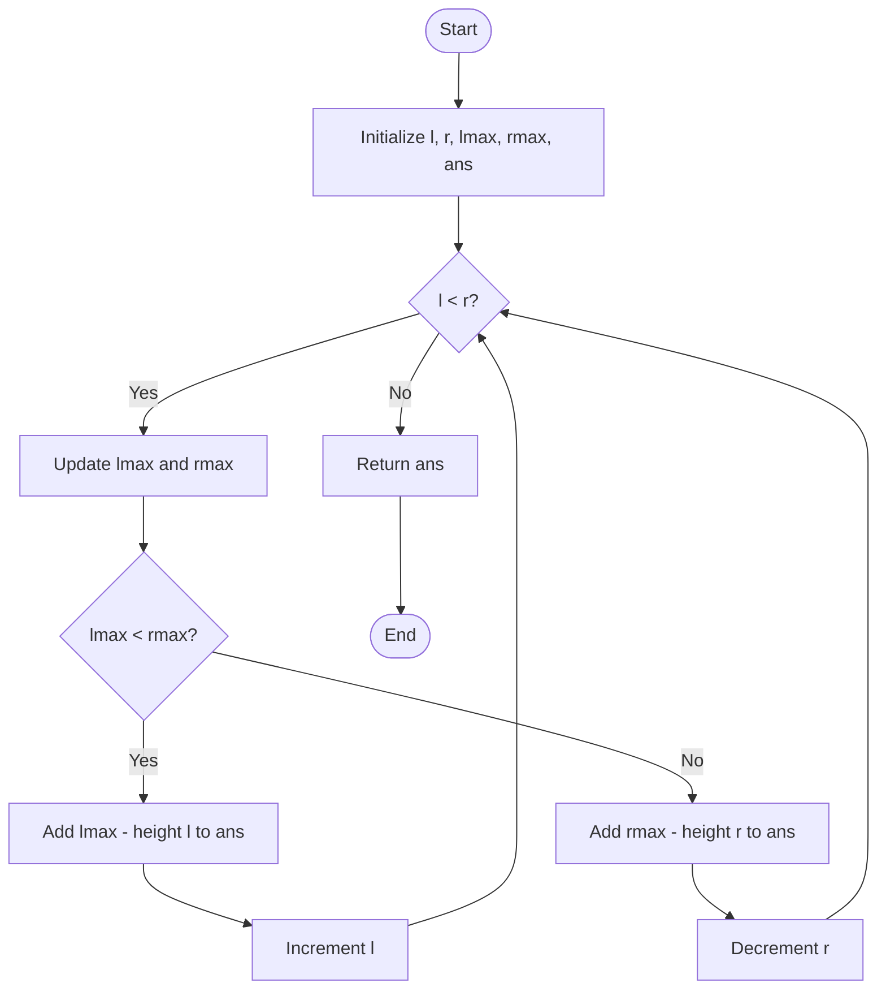

# 🌧️ Trapping Rain Water

## 📌 Approach: Two-Pointer Technique

This solution calculates the total amount of rainwater trapped between bars using two pointers (`l` and `r`) and two variables (`lmax` and `rmax`) to track the maximum heights from both sides.

### ⚙️ Workflow

1. Initialize two pointers: `l = 0` and `r = n - 1`.
2. Initialize `lmax = 0`, `rmax = 0`, and `ans = 0`.
3. Update the maximum heights from the left and right.
4. If `lmax < rmax`, calculate the trapped water at the left pointer and move `l` forward.
5. Otherwise, calculate the trapped water at the right pointer and move `r` backward.
6. Repeat until both pointers meet.
7. Return `ans`, the total trapped rainwater.

### 🔄 Flowchart

### ⏱️ Complexity Analysis

* **Time Complexity:** `O(n)` — Each pointer moves through the array at most once.
* **Space Complexity:** `O(1)` — Only a constant number of extra variables are used.
